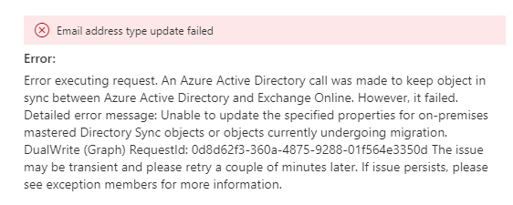
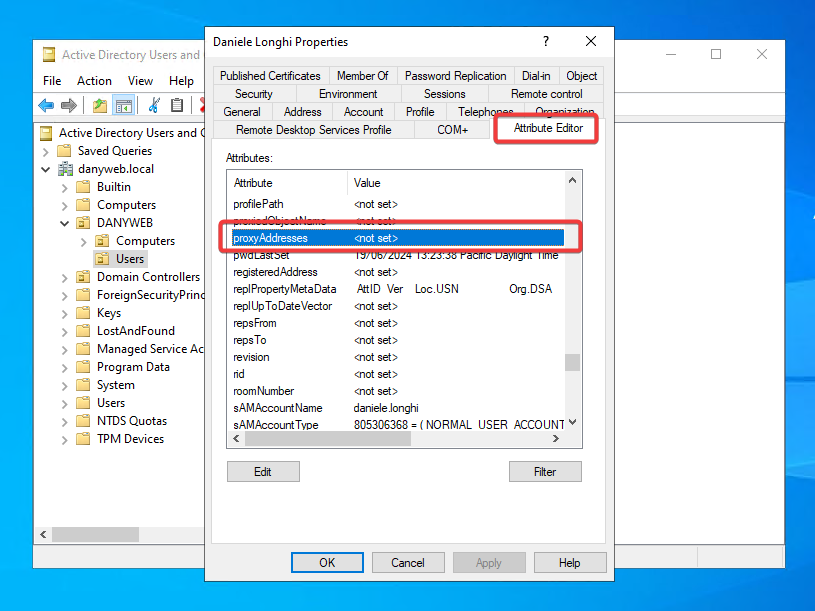
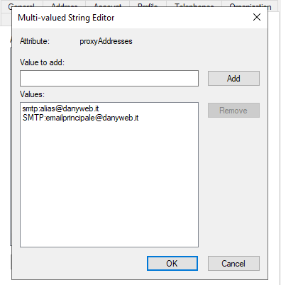

Se si usa **Microsoft 365** in modalità ibrida sincronizzando gli utenti da **Active Directory (AD)** utilizzando **Microsoft Entra Connect**, una delle prime cose da imparare è che “quello che nasce on-premise va gestito on-premise”.
Qualche giorno fa stavo appunto lavorando in un’organizzazione con AD locale e account di posta **Exchange Online cloud only** ed aggiungendo un alias di posta elettronica sul portale Admin M365 ottengo un bel messaggio di errore.

Mi ricordo dell’insegnamento; dovevo creare l’alias on-premise.

## Come creare alias Exchange Online da Active Directory
Apri **Active Directory Users and Computers** (ADUC) abilitando la visualizzazione avanzata dal menu **view**.  
All’interno dell’utente spostati sul tab **Attribute Editor** e trova **proxyAddresses** tra gli i valori presenti.  

Ora aggiungi l’alias facendo attenzione a come lo scrivi:

- utilizza il formato **SMTP:[indirizzo-principale@dominio.xx](mailto:indirozzo-principale@daominio.xx)** per l’indirizzo principale (SMTP scritto in maiuscolo)  
- utilizza il formato **smtp:[alias@dominio.xx](mailto:alias@dominio.xx)** per l’alias (smtp scritto in minuscolo)

Attendi che l’utenza aggiornata venga sincronizzata dall'on-prem in M365 e il tuo alias sarà attivo.

## Bibliografia
[Netwrix](https://blog.netwrix.com/2017/02/02/using-ad-to-add-an-alias-to-an-office-three-six-five-email-account/)