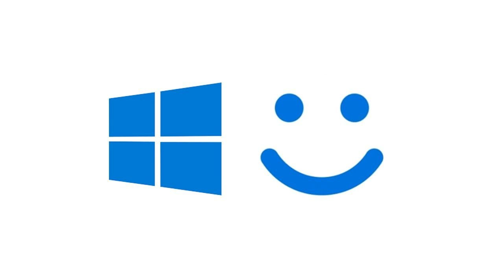
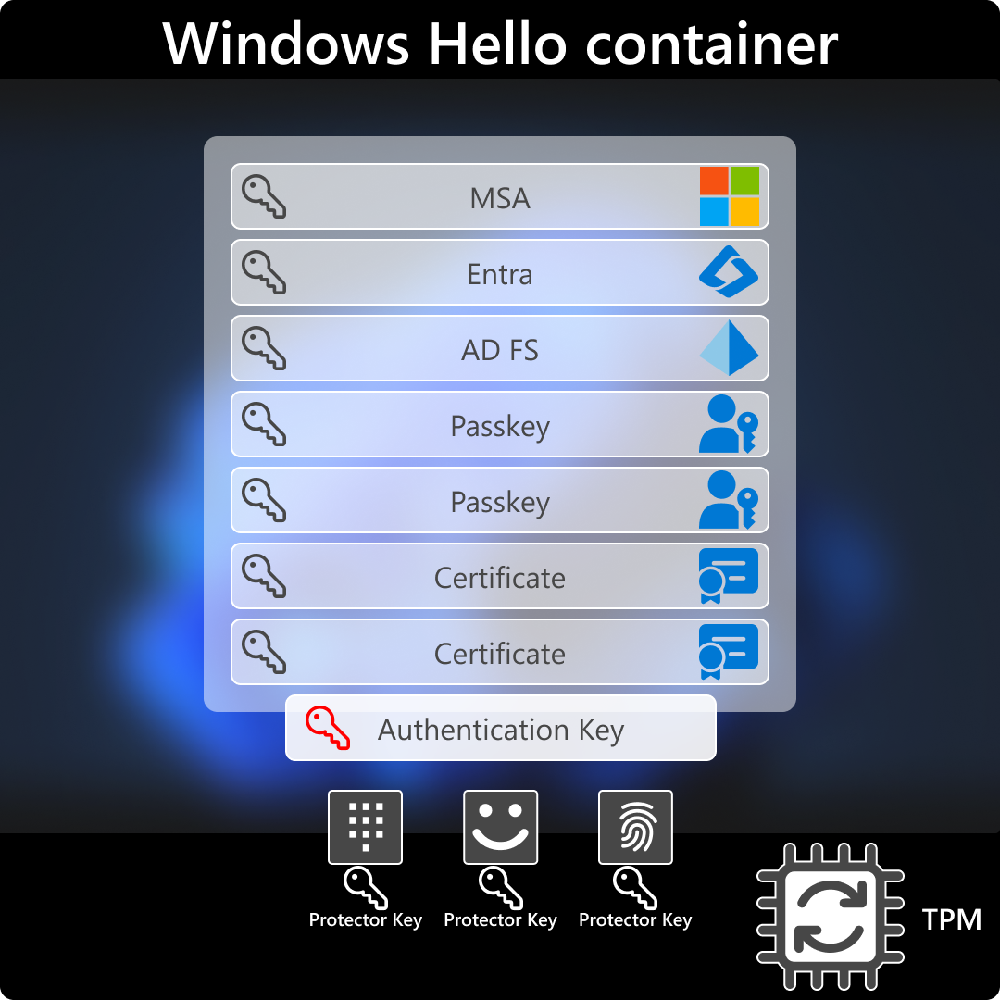
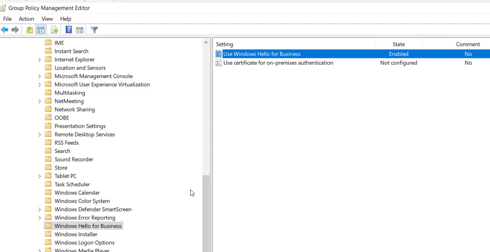
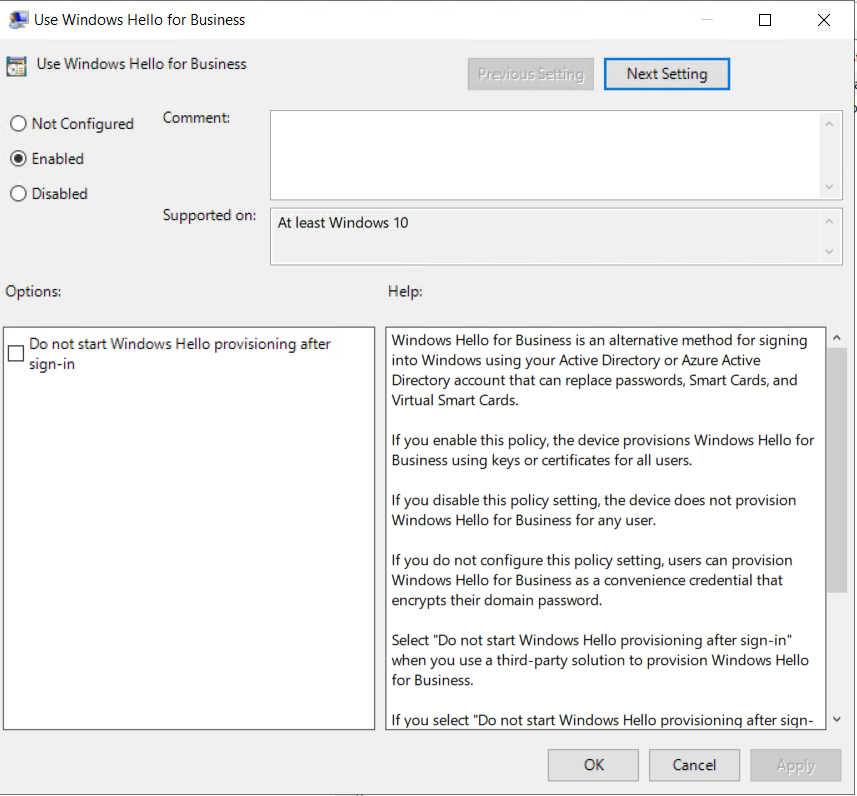
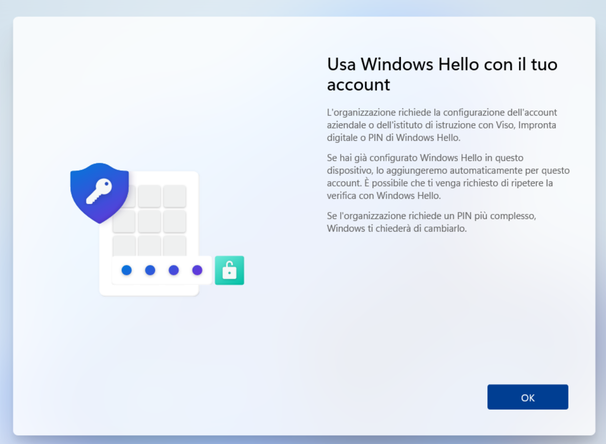
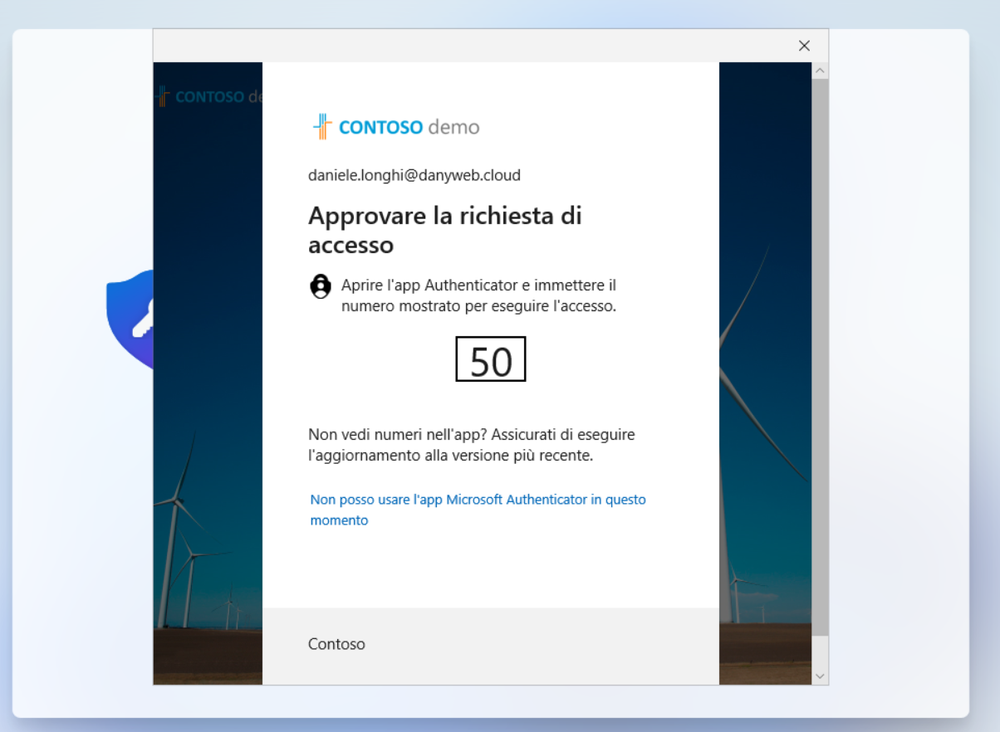
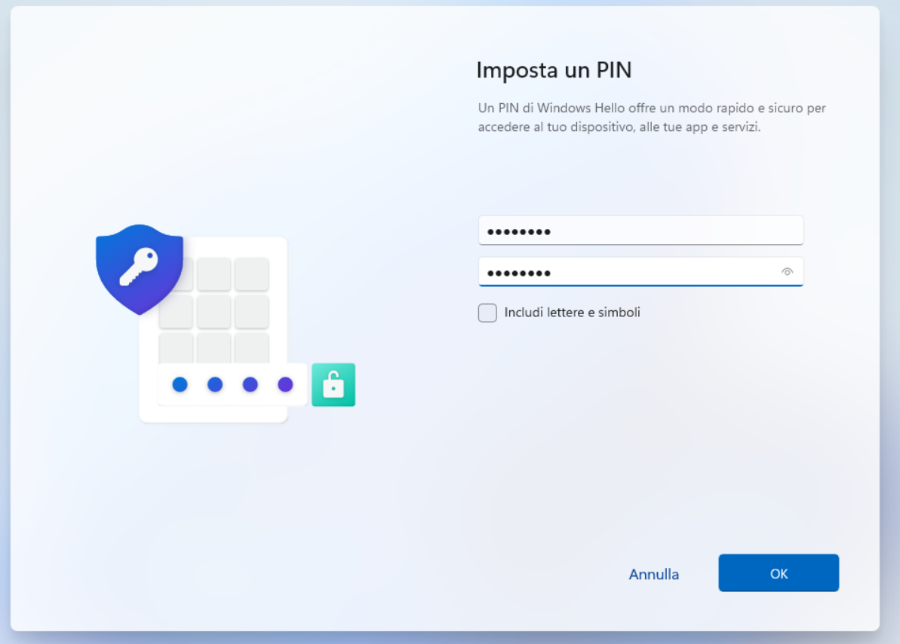
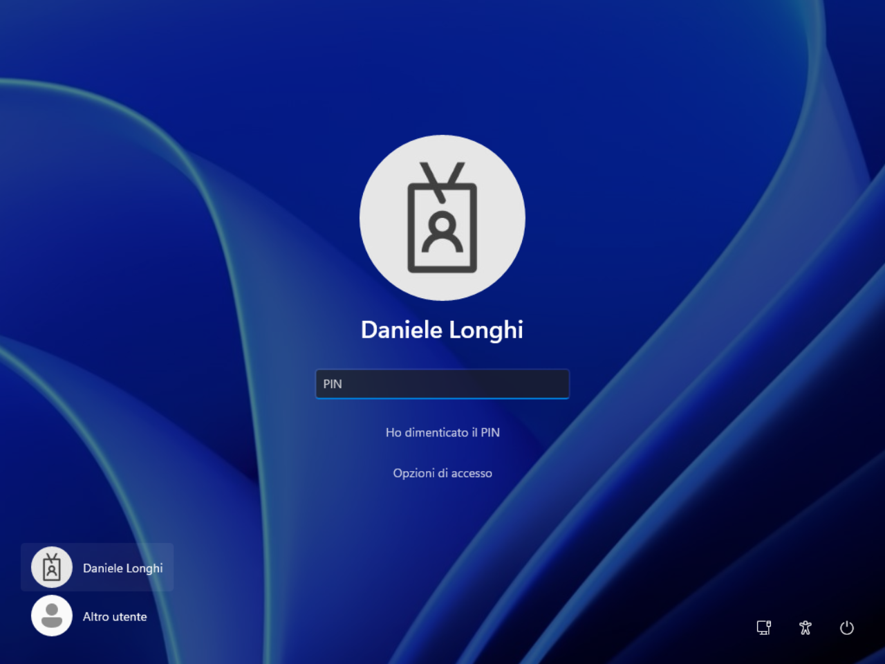

**Windows Hello for Business** è una funzionalità introdotta con Windows
10 che consente di accedere ai dispositivi Windows utilizzando il
riconoscimento facciale, l\'impronta digitale, un PIN o una Security
Key. Questa guida vi mostrerà come abilitare Windows Hello for Business.

## Prerequisiti

Per poter utilizzare Windows Hello for Business, è necessario rispettare
alcuni prerequisiti:

Ambienti Cloud only:
-   Windows 10 versione 1511 o successiva
-   Account Microsoft Azure
-   Azure Active Directory
-   Autenticazione a più fattori di Azure (multi-factor authentication)

Per configurazione Hybrid o On-Premises:
-   Windows 10 versione 1703 o successiva
-   Certificati digitali
-   Hybrid e On-premises Windows Hello for Business deployment
-   Dispositivi Azure AD joined, Hybrid Azure AD joined e Enterprise
    joined

## Come funziona Windows Hello for Business

Windows Hello for Business, configurato da criteri di gruppo (GPO) o da
un tool di gestione di dispositivi mobili (MDM) come Intune, utilizza
una delle modalità di autenticazione scelta (PIN, biometrico, etc) per
sbloccare la chiave privata di autenticazione protetta dal TPM. WHfB usa
poi la chiave privata per firmare in modo crittografato i dati di
identificazione utente inviati al provider di identità che ne verifica
l\'identità e lo autentica.

Ho parlato in questo articolo di come sia [sicuro autenticarsi usando
Windows Hello for
Business](/posts/windows-hello-for-business-tu-sei-la-chiave/).

_Windows Hello Container_

### Chi è l'IdP?

-   Per le distribuzioni cloud e ibride, il provider di identità è
    Microsoft Entra ID
-   Per le distribuzioni locali, il provider di identità è Active
    Directory Federation Services (AD FS).

## Abilitazione di Windows Hello for Business

Per abilitare Windows Hello for Business, è sufficiente distribuire una
Group Policy (GPO) e modificare il parametro: **User Configuration** \>
**Policies** \> **Administrative Templates** \> **Windows Component** \>
**Windows Hello for Business** configurandolo su **Enabled**.

_User Group Policy Windows Hello for Business_

_Descrizione della policy_

### Esperienza utente

All'avvio successivo del computer, dopo che l'utente ha inserito le
proprie credenziali, verrà avviato il processo di OnBoarding
step-by-step di Windows Hello for Business.

_WHfB processo di Onboarding_

Autenticazione MFA per convalida delle credenziali (ambiente cloud)

_Conferma dell'MFA_

Impostazione del PIN di accesso

_Creazione del PIN_

Al successivo avvio del sistema l'utente potrà autenticarsi a Windows
utilizzando il PIN in alternativa alla password di accesso.

_Accesso tramite PIN_

## Bibliografia

-   Microsoft - [Come funziona Windows Hello for Business](https://learn.microsoft.com/it-it/windows/security/identity-protection/hello-for-business/how-it-works)
-   ICTPower - [Utilizzare Windows Hello for Business](https://www.ictpower.it/sistemi-operativi/utilizzare-windows-hello-for-business-per-laccesso-ad-active-directory-ed-azure-ad.htm)
