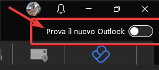
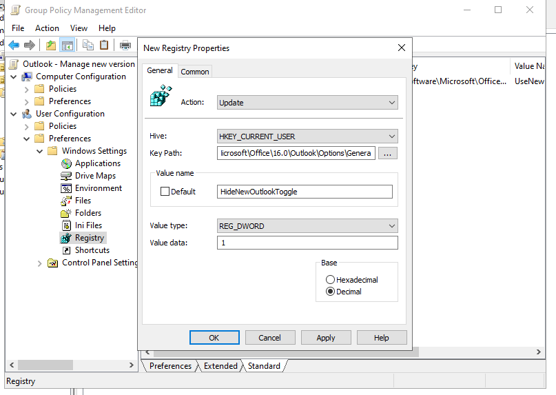
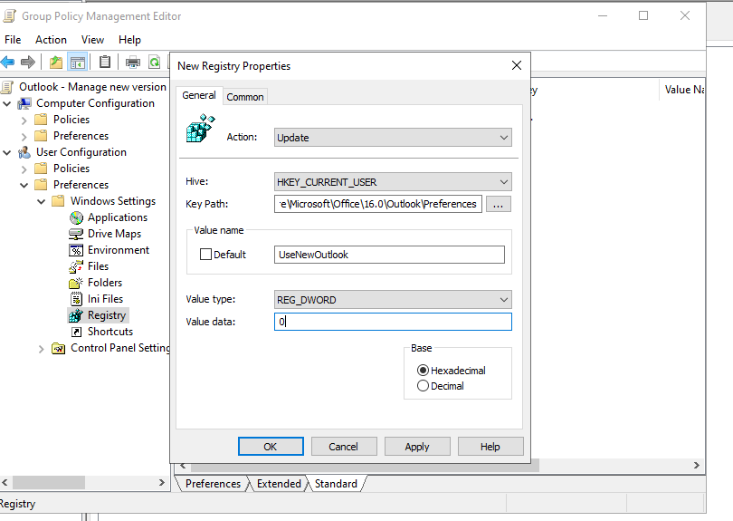

Microsoft sta lavorando ad una nuova interfaccia aggiornata per l’applicazione Outlook rendendone possibile la prova tramite switch “**Prova il nuovo Outlook**”.   
Come spesso accade nelle prime versioni di nuove applicazioni, la presenza di bug non è da escludere; come sysadmin della tua organizzazione potresti voler nascondere agli utenti la possibilità di provare il nuovo Outlook preferendo la versione “stabile” e per quelli che hanno deciso di utilizzare la nuova versione forzare il rollback. Tutto può essere gestito tramite **Group Policy** (GPO).



## Usare le GPO per gestire il nuovo Outlook

Utilizzando due chiavi di registro in una semplice GPO è possibile governare il rollback alla versione stabile di Outlook e nascondere lo switch che permette l’utilizzo della nuova versione.

### Tornare alla versione stabile di Outlook

Per eseguire in modo centralizzato il rollback e tornare alla versione stabile di Outlook usa la chiave “**UseNewOutlook**”

```
Windows Registry Editor Version 5.00

[HKEY_CURRENT_USER\Software\Microsoft\Office\16.0\Outlook\Preferences] 
"UseNewOutlook"=dword:00000000
```

- “0” per disattivare il nuovo Outlook  
- “1” per attivare il nuovo Outlook

### Disabilitare lo switch per il nuovo Outlook

Se vuoi rimuovere la possibilità di passare nuovamente al nuovo Outlook e nascondere lo switch che permette questo cambiamento, puoi modificare la chiave di registro “**HideNewOutlookToggle**”:

```
Windows Registry Editor Version 5.00

[HKEY_CURRENT_USER\Software\Microsoft\Office\16.0\Outlook\Options\General]
"HideNewOutlookToggle"=dword:00000001
```

- “0” rende visibile lo switch  
- “1” nasconde lo switch

Ora non ti resta che inserire le due chiavi in un GPO e distribuirla ai tuoi utenti.





## Bibliografia

[Microsoft](https://learn.microsoft.com/en-us/exchange/clients-and-mobile-in-exchange-online/outlook-on-the-web/enable-disable-employee-access-new-outlook)  
