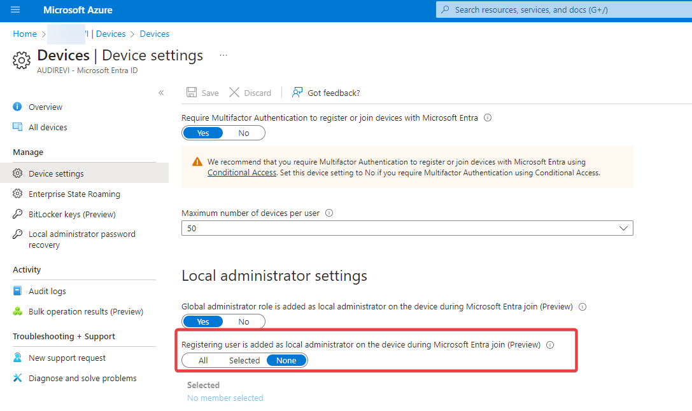

Quando si effettua il **join** di un dispositivo a **Microsoft Entra ID**, l'utente usato per il join viene aggiunto automaticamente al gruppo dei local **administrators**. Questa configurazione risulta contraria a tutte le best-practices di security comportando notevoli rischi perché l'uso di utenze con privilegi elevati permette di modificare impostazioni, accedere a dati di altri utenti o installare applicazioni non autorizzate.

## Rispettare il principio del least privilege
Per rispettare il principio del **least privilege (PoLP)**, [dopo aver effettuato il join di un dispositivo con Microsoft Entra ID](/posts/dispositivi-microsoft-entra-joined-guida-steb-by-step/), è sufficiente limitare i permessi assegnati all'utente che effettua il join del dispositivo ad Entra ID.

Per assegnare i privilegi minimi bisogna usare un'opzione che si trova nel portale **Entra ID** > **Device** > **Device settings** nella sezione **Local administrator settings** che assegna i priviledi di **standard user** a chi effettua il join. Quesra opzione è in preview!

Sarà possibile aumentare i privilegi dell'utente, se strettamente necessario, in una fase successiva  utilizzando Intune o eseguendo alcune operazione manuali. Lo spiegherò in un prossimo articolo. Stay tuned!
