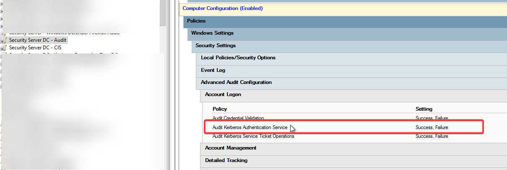
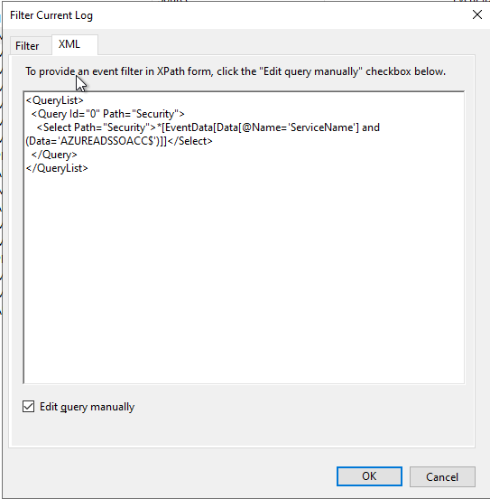
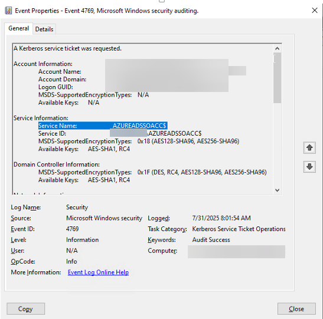
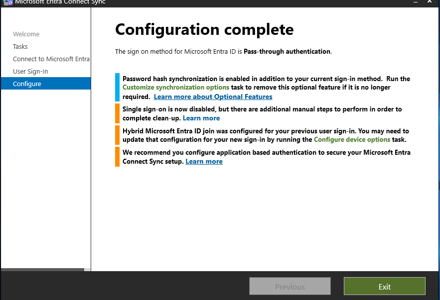
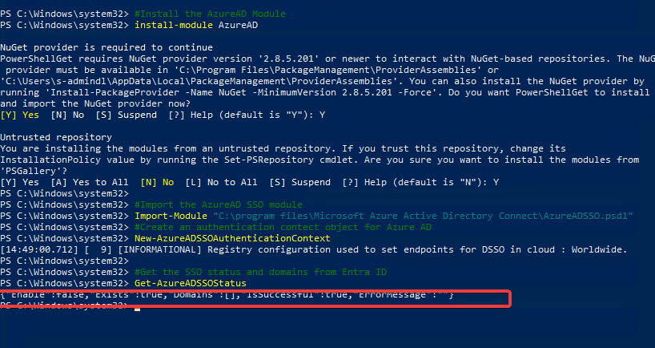
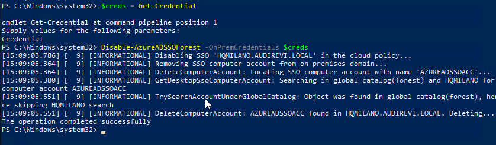
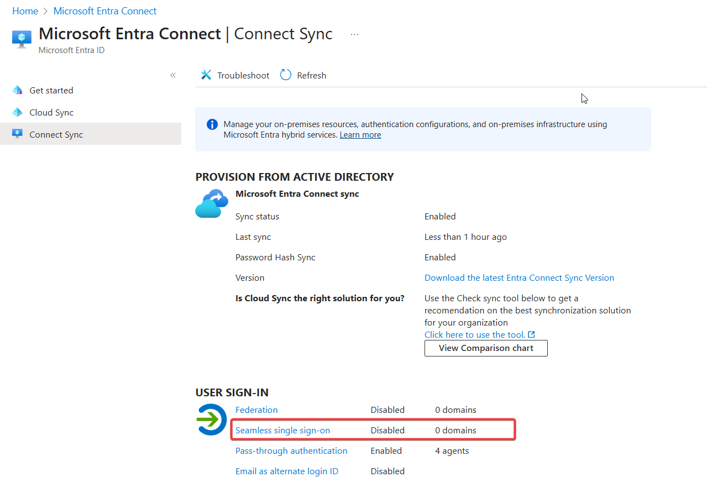

Il **Seamless Single Sign-On** (Seamless SSO) di **Microsoft Entra Connect** permette gli utenti di accedere automaticamente alle applicazioni cloud-based quando sono connessi alla rete aziendale **Active Directory**, senza dover continuamente reinserire le proprie credenziali.  
È una comodità per gli utenti ibridi, ma non sempre una buona idea dal punto di vista della sicurezza e della gestione.

In questo approfondimento vedremo **perché potresti volerlo disattivare**, **quando è sicuro farlo** e **come procedere** in modo corretto.

## Come funzione Seamless SSO
Quando abiliti il Seamless SSO, in **Active Directory on-premises** viene creato un account computer chiamato `AZUREADSSOACC`.  
Questo account è fondamentale per il processo di autenticazione: insieme a esso vengono creati degli **SPN (Service Principal Name) Kerberos** e la chiave di decrittazione dell’account viene condivisa con **Microsoft Entra ID**.

In pratica, questo account contiene un **chiave condivisa** (una password/chiave di decrittazione) che Microsoft Entra ID utilizza per decifrare e validare i ticket Kerberos.  
Quando un dispositivo utente presenta un ticket Kerberos a Entra ID, quest’ultimo usa la chiave condivisa per verificare che il ticket sia legittimo e rilasciato dal controller di dominio on-premises. Se la validazione ha successo, Microsoft Entra ID concede l’accesso alla risorsa cloud senza richiedere ulteriori credenziali.

Il flusso di autenticazione del Seamless SSO funziona così:

1. L’utente tenta di accedere a un’applicazione di Microsoft 365.  
2. Viene richiesto di inserire lo username.  
3. Entra ID chiede all’applicazione di fornire un ticket Kerberos.  
4. L’applicazione richiede un ticket a Active Directory per l’account `AZUREADSSOACC`.  
5. Active Directory rilascia il ticket e l’applicazione lo inoltra a Microsoft Entra ID.  
6. Entra ID decifra il ticket, che contiene l’identità dell’utente.  
7. Se valido, Entra ID restituisce un token di accesso all’applicazione o, se previsto, richiede MFA.  
8. L’utente ottiene l’accesso alla risorsa.

## Perché disattivare il Seamless SSO
Il motivo principale per disattivare il Seamless SSO è legato a un principio di sicurezza fondamentale: **ridurre la superficie di attacco** tra l’ambiente on-premises e il cloud. Uno studio di **SecureWorks** (anche se non recentissimo) ha dimostrato come questa funzionalità possa essere sfruttata per condurre attacchi di brute force contro Microsoft Entra ID in modo invisibile ai sistemi di monitoraggio tradizionali e alle policy di accesso condizionale. In pratica, un aggressore potrebbe usare l’account computer del Seamless SSO per creare richieste di autenticazione falsificate, aggirando i controlli.

Il Seamless SSO nasce per dare accesso senza password ai dispositivi domain-joined che non supportano i **Primary Refresh Token (PRT)**. Fortunatamente, questo scenario è sempre più raro: oggi, i PRT sono supportati dalla maggior parte dei dispositivi moderni (Windows 10 e successivi, oltre a macOS, iOS e Android) e consentono il Single Sign-On senza dipendere da Kerberos.

Seamless SSO e PRT possono coesistere, ma il **PRT ha sempre la priorità quando disponibile**. Proprio per questo, nelle **raccomandazioni di sicurezza di Microsoft** si consiglia di disattivare il Seamless SSO se non viene più utilizzato.

## Quando è sicuro (e consigliato) disattivarlo

Puoi considerare la disattivazione del Seamless SSO quando:
- Tutti i dispositivi aziendali sono aggiornati e supportano i Primary Refresh Token (PRT) — ad esempio Windows 10 o successivi, macOS, oltre a dispositivi mobili iOS e Android.
- L’MFA è attivo e obbligatorio per tutti gli utenti e le applicazioni.
- Nessuna applicazione legacy richiede esplicitamente Kerberos tramite Seamless SSO.
- Vuoi ridurre la superficie di attacco tra on-premises e cloud, prevenendo possibili exploit dell’account Seamless SSO in scenari di brute force non rilevati.

💡 Suggerimento: prima di disattivare il Seamless SSO, abilita l’**Audit sul dominio** (vedi capitolo successivo) per monitorare quali dispositivi e utenti lo stanno ancora utilizzando. In questo modo avrai un quadro chiaro dell’impatto e potrai pianificare una rimozione sicura.

# Come disattivare il Seamless SSO in Microsoft Entra Connect
## Audit
Verificare la presenza di dispositivi e utenti che utilizzano Seamless SSO è fondamentale per procedere in sicurezza alla disattivazione del servizio. La via più accurata per fare questo è abilitare gli **audit log** sui domain controller (DC) e ricercare evento con **ID 4769**. Questo utente associato con il computer account **AZUREADSSOACC$** individua l'utilizzo di Seamless SSO.

Per abilitare l'audit:
- Collegarsi al computer di management e aprire **Group Policy Editor**.
- Creare una nuova policy.
- Espandere **Computer Configuration > Policies > Windows Settings > Security Settings > Advanced Audit Policy Configuration > Audit Policies > Account Logon**.
- Abilitare success e failure per **Audit Kerberos Authentication Service**.

 

### Verificare la presenza di eventi nei log
Passati almeno 15 giorni dall'abilitazione dei log è il momento di verificare chi sono i nostri sfacciati utenti che utilizzano ancora la funzionalità di Seamless SSO.

La ricerca nei **security events** di quello con ID 4769 legato a AZUREADSSOACC$ può risultare tediosa; un buon filtro può semplificare la ricerca:

```
<QueryList>
    <Query Id="0" Path="Security">
      <Select Path="Security">*[EventData[Data[@Name='ServiceName'] and (Data='AZUREADSSOACC$')]]</Select>
    </Query>
  </QueryList>
```


Una volta applicato il filtro, il risultato è facilmente consultabile:


## Disabilitare Seamless SSO
La disabilitazione di Seamless SSO avviene in due passaggi:
1. Disabilitare Seamless SSO in Microsoft Entra Connect
2. Pulire Active Directory

Per disabilitare Seamless SSO in Microsoft Entra Connect, gli step sono questi:
- Collegarsi al computer che esegue Microsoft Entra Connect Sync
- Cliccare **Configure**.
- Selezionare **Change User Sign In** e **Next**.
- Nella sezione **User Sign-In**, deselezionare **Enable single sign-on** e proseguire con **Next**. 



Ora ripristinare Active Directory:
- Nel computer di gestione di Active Directory (io ho usato quello su cui è installato Entra Connect), aprire Powershell come amministratore ed installare il modulo **AzureADSSO**:

```
#Install the AzureAD Module
install-module AzureAD

#Import the AzureAD SSO module
Import-Module "C:\program files\Microsoft Azure Active Directory Connect\AzureADSSO.psd1"
```

Il comando seguente restituisce la lista di tutte le foreste che hanno Seamless SSO abilitato:

```
#Create an authentication contect object for Azure AD
New-AzureADSSOAuthenticationContext

#Get the SSO status and domains from Entra ID
Get-AzureADSSOStatus
```

L'output sarà simile a quello dell'immagine sottostante.


- Ora è possibile eseguire i comandi per eliminare in modo sicuro l'oggetto `AZUREADSSOACC`.

```
#Store domain admin credentials
$creds = Get-Credential

#Disable SSO in the forest
Disable-AzureADSSOForest -OnPremCredentials $creds
```


## Verificare che Seamless SSO sia disattivata
Per assicurarti che il Seamless SSO sia stato effettivamente disattivato nel tuo ambiente, accedi al **Microsoft Entra admin center** e segui questo percorso: **Entra ID > Entra Connect**. 

All’interno della pagina dedicata, verifica che la voce relativa al Seamless single sign-on risulti **Disattivata**.



Inoltre, in Active Directory controlla che l’oggetto computer `AZUREADSSOACC` non sia più presente: la sua rimozione conferma che la configurazione di Seamless SSO è stata eliminata anche a livello on-premises.

## Bibliografia
- [OurCloudNetwork](https://ourcloudnetwork.com/why-you-should-disable-seamless-sso-in-microsoft-entra-connect/)
- [Microsoft](https://learn.microsoft.com/en-us/entra/identity/hybrid/connect/tshoot-connect-sso)
- [SecureWorks - Undetected Azure Active Directory Brute-Force Attacks](https://www.secureworks.com/research/undetected-azure-active-directory-brute-force-attacks)