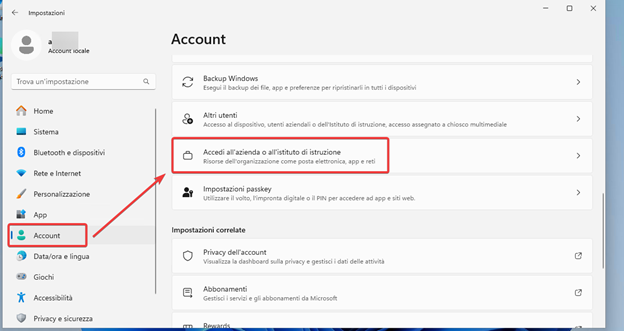
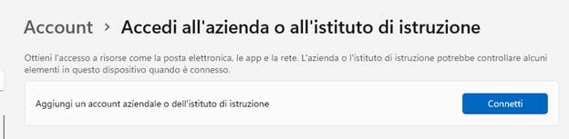
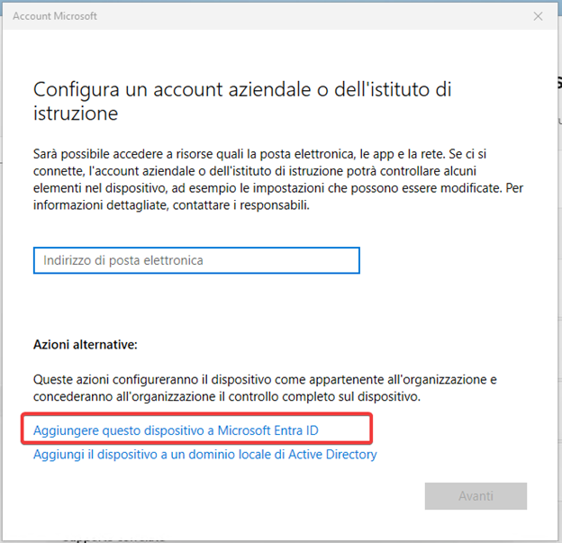
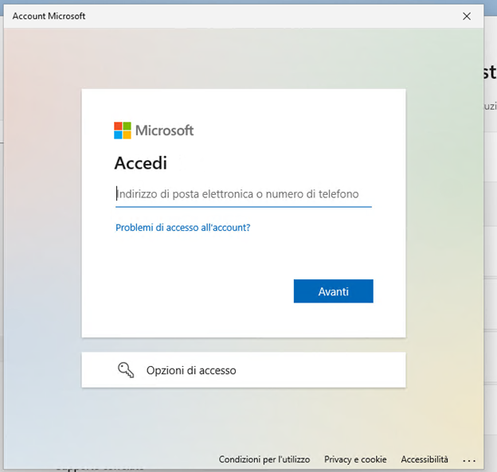
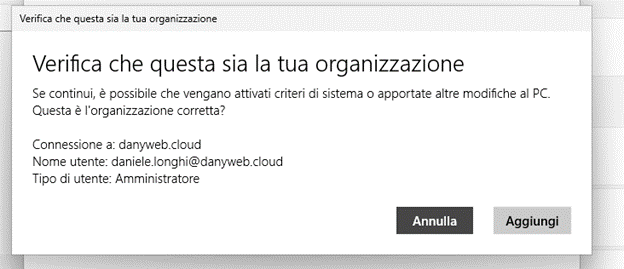
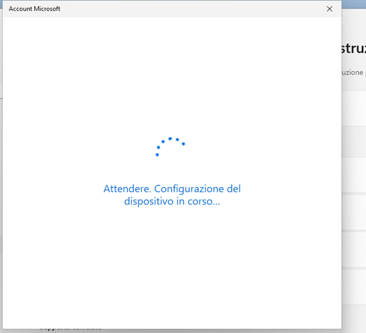
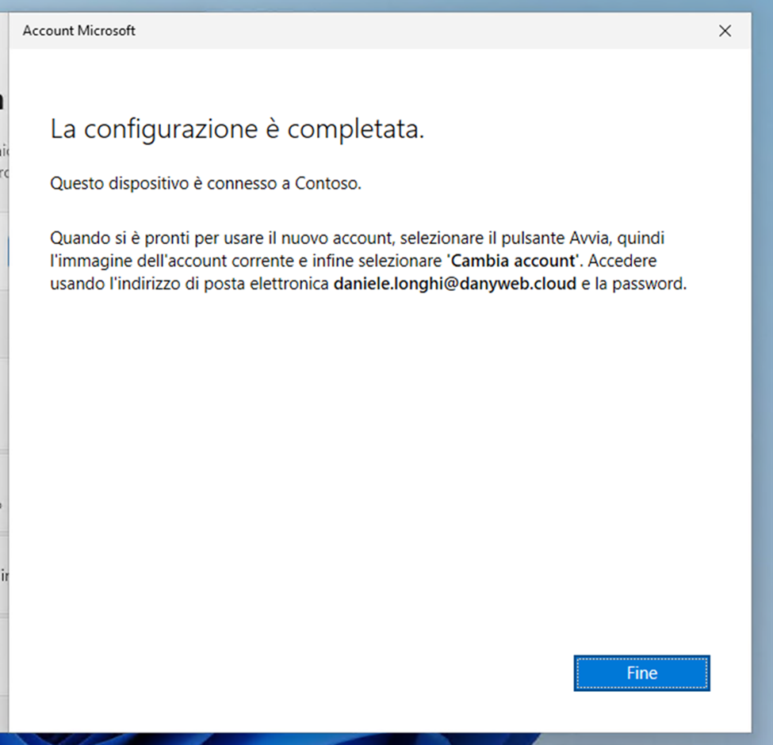
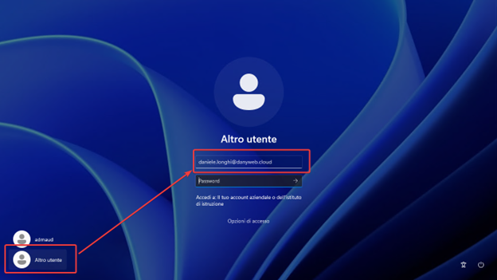
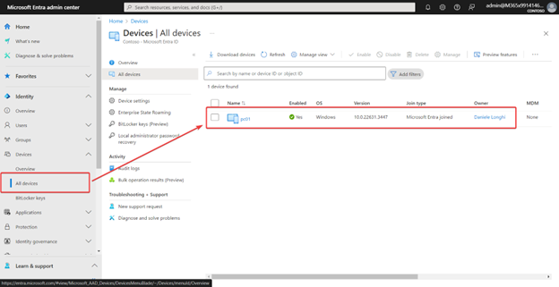

Nell’era del **cloud**, l’efficienza passa attraverso la gestione ottimale dei dispositivi. **Microsoft Entra ID** si pone come uno dei mattoni fondamentali per garantire l’autenticazione e l’autorizzazione di utenti e dispositivi nell’universo dei servizi cloud Microsoft, tra questi  Office 365, SharePoint e Teams.

Ma come si può integrare efficacemente un dispositivo con Microsoft Entra ID? 

Esistono tre strade principali:
- la registrazione con Microsoft Entra Registered
- l’integrazione con Microsoft Entra joined 
- la combinazione ibrida con Microsoft Entra Hybrid Joined e AD DS

Questo articolo vuole essere la guida per comprendere le differenze tra i vari metodi e per imparare come integrare i tuoi dispositivi con Microsoft Entra joined, assicurandoti così un’esperienza cloud senza problemi. 
- **Microsoft Entra Registered**: Questa modalità rappresenta il primo passo verso l'integrazione cloud, permettendo ai dispositivi di registrarsi in Entra ID. Gli utenti possono accedere alle applicazioni cloud con le proprie credenziali aziendali, mantenendo al contempo l'identità locale o di dominio del dispositivo. Ideale per dispositivi personali o mobili, questa opzione garantisce un accesso sicuro alle risorse cloud senza una gestione diretta da parte di Entra ID.
- **Microsoft Entra joined**: Con questa opzione, il tuo dispositivo diventa un “cittadino” a pieno titolo dell'ecosistema cloud di Microsoft. L'identità locale o di dominio viene sostituita da quella di Entra ID, consentendo una gestione centralizzata e l'applicazione di policy e configurazioni direttamente dal cloud. Perfetto per i dispositivi esclusivamente cloud, Microsoft Entra joined è la soluzione per chi cerca un'integrazione completa con il cloud. 
- **Microsoft Entra Hybrid Joined**: La soluzione ibrida per eccellenza, Microsoft Entra Hybrid Joined, fonde il meglio dei due mondi. Mentre il dispositivo conserva la sua identità locale o di dominio, viene anche registrato in Entra ID, beneficiando di una gestione congiunta. Questa opzione è la scelta prediletta per dispositivi che operano in ambienti misti, offrendo flessibilità e accesso sia alle risorse locali che a quelle cloud.

## L’Integrazione semplice con Microsoft Entra joined
L’integrazione di un dispositivo con Microsoft Entra ID si distingue per la sua semplicità. Non è richiesta alcuna competenza tecnica avanzata, visto che il processo è completamente guidato, assicurando un’esperienza utente fluida. Per i dispositivi dotati di Windows 11 Professional o versioni superiori, l’integrazione è ancora più semplice perché fin dalla fase di avvio OOBE (Out-of-Box Experience), l’utente è accompagnato passo dopo passo nella registrazione, rendendo l’intero procedimento semplice.

Vai nelle **Impostazioni** > **Account**

Connetti con l’azienda il dispositivo.

Nella finestra che si apre seleziona **Aggiungere questo dispositivo a Microsoft Entra ID**

Inserisci le credenziali Microsoft che l’organizzazione ha fornito e completa il processo di autenticazione. Sicuramente ti verrà richiesta un’autenticazione aggiuntiva **MFA** per questo passaggio.

Verifica che i dati inseriti siano corretti

Il processo ora si completa automaticamente.

Configurazione completa! Il dispositivo è ora parte dell'organizzazione.

Non ti resta che usare le credenziali Microsoft Entra ID per autenticarti nel dispositivo appena registrato

Per i **sysadmin** è possibile verificare nel portale **Microsoft Entra Admin Center** che la registrazione del dispositivo sia avvenuta correttamente.

## Bibliografia
- [Microsoft Entra registerd devices](https://learn.microsoft.com/en-us/entra/identity/devices/concept-device-registration)
- [Microsoft Entra joined devices](https://learn.microsoft.com/en-us/entra/identity/devices/concept-directory-join)
- [Microsoft Entra hybrid joined devices](https://learn.microsoft.com/en-us/entra/identity/devices/concept-hybrid-join)

 
 
 

