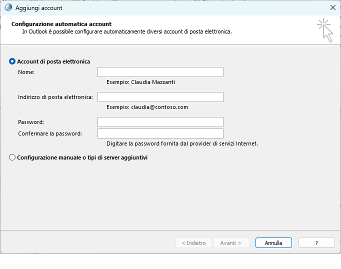
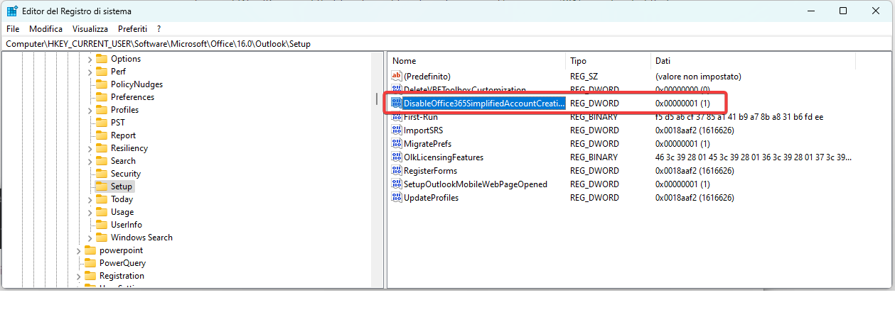

Quando si apre per la priva volta `Microsoft Outlook` (dalla versione 2016 in poi) o si aggiunge un nuovo account e-mail, il `wizard di configurazione` guida l'utente passo-passo nella configurazione dei parametri.

Il wizard, comodo ai più, potrebbe risultare fastidioso se si volesse lavorare con Outlook in modalità "manuale" personalizzando i parametri di configurazione dell'account di e-mail.


_Microsoft Outlook - Configurazione tradizionale_

## Configurazione

Per disabilitare il widard di configurazione è possibile aggiungere una chiave di registro che riattiva la finestra di configurazione tradizionale.
Ecco la chiave di registro da creare:

```
[HKEY_CURRENT_USER\SOFTWARE\Microsoft\Office\16.0\Outlook\Setup]
"DisableOffice365SimplifiedAccountCreation"=dword:00000001
```

_Registro di Windows con la chiave creata_

Se questo post è stato utile lascia un commento.
